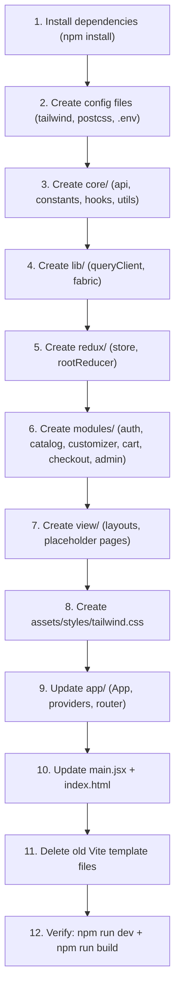

# Danh Sách Chi Tiết Tất Cả Files

> Tổng cộng: **47 files mới** | **2 files chỉnh sửa** | **5 files xóa**
>
> ✅ **Quy tắc ngôn ngữ**: Comment = English | Nội dung UI = Tiếng Việt

---

## 📋 MỤC LỤC

| # | Nhóm | Files mới | Sửa | Xóa |
|---|-------|-----------|-----|-----|
| 1 | [Config (root)](#1-config-root) | 4 | 1 | 0 |
| 2 | [App (src/app/)](#2-app-srcapp) | 3 | 0 | 0 |
| 3 | [Core (src/core/)](#3-core-srccore) | 8 | 0 | 0 |
| 4 | [Lib (src/lib/)](#4-lib-srclib) | 2 | 0 | 0 |
| 5 | [Redux (src/redux/)](#5-redux-srcredux) | 2 | 0 | 0 |
| 6 | [Modules (src/modules/)](#6-modules-srcmodules) | 16 | 0 | 0 |
| 7 | [View - Components (src/view/components/)](#7-view---components) | 8 | 0 | 0 |
| 8 | [View - Pages (src/view/pages/)](#8-view---pages) | 2 | 0 | 0 |
| 9 | [Assets (src/assets/)](#9-assets-srcassets) | 1 | 0 | 0 |
| 10 | [Entry (src/)](#10-entry-src) | 0 | 1 | 0 |
| 11 | [Xóa files cũ](#11-xóa-files-template-vite-cũ) | 0 | 0 | 5 |
| | **TỔNG** | **47** | **2** | **5** |

---

## 1. Config (root)

#### [NEW] `postcss.config.js`
```js
export default {
  plugins: {
    '@tailwindcss/postcss': {},
  },
}
```

---

#### [NEW] `tailwind.config.js`
```js
/** @type {import('tailwindcss').Config} */
export default {
  content: [
    './index.html',
    './src/**/*.{js,jsx}',
  ],
  theme: {
    extend: {
      colors: {
        // Elegant background tones (ivory, light yellow, warm gray)
        ivory: '#FFFFF0',
        'warm-yellow': '#FFF8DC',
        'warm-gray': '#D3D3C0',
        // Cao Dai religious accent colors (Yellow - Blue - Red)
        'dao-yellow': '#DAA520',
        'dao-blue': '#1E90FF',
        'dao-red': '#DC143C',
      },
      fontFamily: {
        sans: ['system-ui', 'Segoe UI', 'Roboto', 'sans-serif'],
        // Calligraphy font for product customization
        calligraphy: ['"Noto Serif"', 'serif'],
      },
    },
  },
  plugins: [],
}
```

---

#### [NEW] `.env.example`
```
VITE_API_URL=http://localhost:3000/api
VITE_APP_NAME=GĐHĐ E-Commerce
```

---

#### [NEW] `.env`
```
VITE_API_URL=http://localhost:3000/api
VITE_APP_NAME=GĐHĐ E-Commerce
```

---

#### [MODIFY] `index.html`

````carousel
**TRƯỚC:**
```html
<!doctype html>
<html lang="en">
  <head>
    <meta charset="UTF-8" />
    <link rel="icon" type="image/svg+xml" href="/favicon.svg" />
    <meta name="viewport" content="width=device-width, initial-scale=1.0" />
    <title>fe</title>
  </head>
  <body>
    <div id="root"></div>
    <script type="module" src="/src/main.jsx"></script>
  </body>
</html>
```
<!-- slide -->
**SAU:**
```html
<!doctype html>
<html lang="vi">
  <head>
    <meta charset="UTF-8" />
    <link rel="icon" type="image/svg+xml" href="/favicon.svg" />
    <meta name="viewport" content="width=device-width, initial-scale=1.0" />
    <title>GĐHĐ E-Commerce</title>
  </head>
  <body>
    <div id="root"></div>
    <script type="module" src="/src/main.jsx"></script>
  </body>
</html>
```
````

> Thay đổi: `lang="en"` → `lang="vi"`, `<title>fe</title>` → `<title>GĐHĐ E-Commerce</title>`

---

## 2. App (`src/app/`)

#### [NEW] `src/app/App.jsx`
```jsx
import { Suspense } from 'react'
import { RouterProvider } from 'react-router-dom'
import Providers from './providers'
import router from './router'

export default function App() {
  return (
    <Providers>
      <Suspense
        fallback={
          <div className="flex items-center justify-center h-screen text-warm-gray">
            Đang tải...
          </div>
        }
      >
        <RouterProvider router={router} />
      </Suspense>
    </Providers>
  )
}
```

---

#### [NEW] `src/app/providers.jsx`
```jsx
import { Provider } from 'react-redux'
import { QueryClientProvider } from '@tanstack/react-query'
import { ReactQueryDevtools } from '@tanstack/react-query-devtools'
import { Toaster } from 'react-hot-toast'
import { store } from '../redux/store'
import { queryClient } from '../lib/queryClient'

/**
 * Root providers wrapper.
 * Wraps the entire app with Redux, React Query, and Toast notification providers.
 */
export default function Providers({ children }) {
  return (
    <Provider store={store}>
      <QueryClientProvider client={queryClient}>
        {children}
        <Toaster position="top-right" />
        <ReactQueryDevtools initialIsOpen={false} />
      </QueryClientProvider>
    </Provider>
  )
}
```

---

#### [NEW] `src/app/router.jsx`
```jsx
import { createBrowserRouter } from 'react-router-dom'
import { lazy } from 'react'
import { ROUTES } from '../core/constants/routes'

// Lazy-loaded layouts (code-splitting per NFR-FE-PERF-03)
const StorefrontLayout = lazy(() => import('../view/components/layout/StorefrontLayout'))
const AdminLayout = lazy(() => import('../view/components/layout/AdminLayout'))

// Storefront pages
const HomePage = lazy(() => import('../view/pages/storefront/HomePage'))
// Uncomment as pages are developed:
// const CategoryPage = lazy(() => import('../view/pages/storefront/CategoryPage'))
// const ProductDetailPage = lazy(() => import('../view/pages/storefront/ProductDetailPage'))
// const CustomizerPage = lazy(() => import('../view/pages/storefront/CustomizerPage'))
// const CartPage = lazy(() => import('../view/pages/storefront/CartPage'))
// const CheckoutPage = lazy(() => import('../view/pages/storefront/CheckoutPage'))
// const LoginPage = lazy(() => import('../view/pages/storefront/LoginPage'))
// const RegisterPage = lazy(() => import('../view/pages/storefront/RegisterPage'))

// Admin pages
const DashboardPage = lazy(() => import('../view/pages/admin/DashboardPage'))
// const ProductListPage = lazy(() => import('../view/pages/admin/ProductListPage'))
// const OrderListPage = lazy(() => import('../view/pages/admin/OrderListPage'))

const router = createBrowserRouter([
  {
    element: <StorefrontLayout />,
    children: [
      { path: ROUTES.HOME, element: <HomePage /> },
      // Uncomment as pages are developed:
      // { path: ROUTES.CATEGORY, element: <CategoryPage /> },
      // { path: ROUTES.PRODUCT_DETAIL, element: <ProductDetailPage /> },
      // { path: ROUTES.CUSTOMIZER, element: <CustomizerPage /> },
      // { path: ROUTES.CART, element: <CartPage /> },
      // { path: ROUTES.CHECKOUT, element: <CheckoutPage /> },
      // { path: ROUTES.LOGIN, element: <LoginPage /> },
      // { path: ROUTES.REGISTER, element: <RegisterPage /> },
      // { path: ROUTES.FORGOT_PASSWORD, element: <ForgotPasswordPage /> },
      // { path: ROUTES.PROFILE, element: <ProfilePage /> },
      // { path: ROUTES.ORDER_HISTORY, element: <OrderHistoryPage /> },
    ],
  },
  {
    path: '/admin',
    element: <AdminLayout />,
    children: [
      { index: true, element: <DashboardPage /> },
      // { path: ROUTES.ADMIN_PRODUCTS, element: <ProductListPage /> },
      // { path: ROUTES.ADMIN_PRODUCT_NEW, element: <ProductFormPage /> },
      // { path: ROUTES.ADMIN_PRODUCT_EDIT, element: <ProductFormPage /> },
      // { path: ROUTES.ADMIN_ORDERS, element: <OrderListPage /> },
      // { path: ROUTES.ADMIN_ORDER_DETAIL, element: <OrderDetailPage /> },
    ],
  },
])

export default router
```

---

## 3. Core (`src/core/`)

#### [NEW] `src/core/api/axiosClient.js`
```js
import axios from 'axios'
import { getToken, setToken, removeToken } from '../utils/storage'

const axiosClient = axios.create({
  baseURL: import.meta.env.VITE_API_URL || 'http://localhost:3000/api',
  timeout: 10000,
  headers: {
    'Content-Type': 'application/json',
  },
})

// Request interceptor — attach JWT token to every request
axiosClient.interceptors.request.use(
  (config) => {
    const token = getToken()
    if (token) {
      config.headers.Authorization = `Bearer ${token}`
    }
    return config
  },
  (error) => Promise.reject(error)
)

// Response interceptor — handle errors & auto-refresh expired tokens (NFR-FE-SEC-02)
axiosClient.interceptors.response.use(
  (response) => response.data,
  async (error) => {
    const originalRequest = error.config

    // Attempt token refresh on 401 Unauthorized
    if (error.response?.status === 401 && !originalRequest._retry) {
      originalRequest._retry = true
      try {
        const { data } = await axios.post(
          `${axiosClient.defaults.baseURL}/auth/refresh`,
          {},
          { withCredentials: true }
        )
        setToken(data.accessToken)
        originalRequest.headers.Authorization = `Bearer ${data.accessToken}`
        return axiosClient(originalRequest)
      } catch (refreshError) {
        removeToken()
        window.location.href = '/login'
        return Promise.reject(refreshError)
      }
    }

    return Promise.reject(error)
  }
)

export default axiosClient
```

---

#### [NEW] `src/core/api/endpoints.js`
```js
/**
 * Centralized API endpoint definitions.
 * All backend routes are defined here for easy maintenance.
 */
export const ENDPOINTS = {
  // Authentication
  AUTH_LOGIN: '/auth/login',
  AUTH_REGISTER: '/auth/register',
  AUTH_REFRESH: '/auth/refresh',
  AUTH_FORGOT_PASSWORD: '/auth/forgot-password',
  AUTH_PROFILE: '/auth/profile',

  // Categories
  CATEGORIES: '/categories',

  // Products
  PRODUCTS: '/products',
  PRODUCT_DETAIL: (id) => `/products/${id}`,
  PRODUCT_SEARCH: '/products/search',

  // Customizer templates & motifs
  TEMPLATES: '/templates',
  MOTIFS: '/motifs',

  // Orders
  ORDERS: '/orders',
  ORDER_DETAIL: (id) => `/orders/${id}`,

  // Address (province/district/ward hierarchy)
  PROVINCES: '/address/provinces',
  DISTRICTS: (provinceId) => `/address/provinces/${provinceId}/districts`,
  WARDS: (districtId) => `/address/districts/${districtId}/wards`,

  // Admin
  ADMIN_PRODUCTS: '/admin/products',
  ADMIN_ORDERS: '/admin/orders',
  ADMIN_DASHBOARD: '/admin/dashboard/stats',
}
```

---

#### [NEW] `src/core/constants/routes.js`
```js
/**
 * Client-side route path constants.
 * Used by React Router and navigation links.
 */
export const ROUTES = {
  // Storefront routes
  HOME: '/',
  CATEGORY: '/category/:slug',
  PRODUCT_DETAIL: '/product/:id',
  CUSTOMIZER: '/product/:id/customize',
  CART: '/cart',
  CHECKOUT: '/checkout',
  LOGIN: '/login',
  REGISTER: '/register',
  FORGOT_PASSWORD: '/forgot-password',
  PROFILE: '/profile',
  ORDER_HISTORY: '/orders',

  // Admin portal routes
  ADMIN_DASHBOARD: '/admin',
  ADMIN_PRODUCTS: '/admin/products',
  ADMIN_PRODUCT_NEW: '/admin/products/new',
  ADMIN_PRODUCT_EDIT: '/admin/products/:id/edit',
  ADMIN_ORDERS: '/admin/orders',
  ADMIN_ORDER_DETAIL: '/admin/orders/:id',
}
```

---

#### [NEW] `src/core/constants/config.js`
```js
/**
 * Global application configuration constants.
 */
export const APP_CONFIG = {
  APP_NAME: import.meta.env.VITE_APP_NAME || 'GĐHĐ E-Commerce',
  PAGINATION: {
    DEFAULT_PAGE_SIZE: 12,
    ADMIN_PAGE_SIZE: 20,
  },
  CUSTOMIZER: {
    MAX_TEXT_LENGTH: 50,
    ALLOWED_FONTS: ['Noto Serif', 'Roboto', 'Open Sans'],
  },
  CURRENCY: {
    LOCALE: 'vi-VN',
    CURRENCY_CODE: 'VND',
  },
}
```

---

#### [NEW] `src/core/utils/storage.js`
```js
/**
 * LocalStorage helpers for JWT token management.
 */
const TOKEN_KEY = 'gdhd_access_token'

export const getToken = () => localStorage.getItem(TOKEN_KEY)
export const setToken = (token) => localStorage.setItem(TOKEN_KEY, token)
export const removeToken = () => localStorage.removeItem(TOKEN_KEY)
```

---

#### [NEW] `src/core/utils/formatCurrency.js`
```js
import { APP_CONFIG } from '../constants/config'

/**
 * Format a number as Vietnamese Dong (VND) currency string.
 * @param {number} amount - The amount to format
 * @returns {string} Formatted string, e.g. "1.250.000 ₫"
 */
export function formatCurrency(amount) {
  return new Intl.NumberFormat(APP_CONFIG.CURRENCY.LOCALE, {
    style: 'currency',
    currency: APP_CONFIG.CURRENCY.CURRENCY_CODE,
  }).format(amount)
}
```

---

#### [NEW] `src/core/utils/validators.js`
```js
import { z } from 'zod'

/**
 * Shared Zod validation schemas used across multiple modules.
 */

// Vietnamese phone number format: starts with 03, 05, 07, 08, or 09 followed by 8 digits
export const phoneSchema = z
  .string()
  .regex(/^(0[3|5|7|8|9])+([0-9]{8})$/, 'Số điện thoại không hợp lệ')

export const emailSchema = z
  .string()
  .email('Email không hợp lệ')

/**
 * Creates a required string schema with a custom Vietnamese error message.
 * @param {string} fieldName - The field display name (in Vietnamese)
 */
export const requiredString = (fieldName) =>
  z.string().min(1, `${fieldName} không được để trống`)
```

---

#### [NEW] `src/core/hooks/useAuth.js`
```js
import { useSelector } from 'react-redux'

/**
 * Hook to access the current authentication state from Redux store.
 * @returns {{ user: object|null, isAuthenticated: boolean, isLoading: boolean }}
 */
export function useAuth() {
  const { user, isAuthenticated, isLoading } = useSelector((state) => state.auth || {})

  return {
    user: user || null,
    isAuthenticated: isAuthenticated || false,
    isLoading: isLoading || false,
  }
}
```

---

#### [NEW] `src/core/hooks/useMediaQuery.js`
```js
import { useState, useEffect } from 'react'

/**
 * Generic hook to evaluate a CSS media query.
 * @param {string} query - A CSS media query string
 * @returns {boolean} Whether the media query currently matches
 */
export function useMediaQuery(query) {
  const [matches, setMatches] = useState(false)

  useEffect(() => {
    const media = window.matchMedia(query)
    setMatches(media.matches)

    const listener = (e) => setMatches(e.matches)
    media.addEventListener('change', listener)
    return () => media.removeEventListener('change', listener)
  }, [query])

  return matches
}

/**
 * Responsive breakpoint hooks per SRS requirements:
 * - Mobile:  375px – 640px
 * - Tablet:  641px – 1024px
 * - Desktop: >= 1025px
 */
export function useIsMobile() {
  return useMediaQuery('(max-width: 640px)')
}

export function useIsTablet() {
  return useMediaQuery('(min-width: 641px) and (max-width: 1024px)')
}

export function useIsDesktop() {
  return useMediaQuery('(min-width: 1025px)')
}
```

---

## 4. Lib (`src/lib/`)

#### [NEW] `src/lib/queryClient.js`
```js
import { QueryClient } from '@tanstack/react-query'

/**
 * TanStack Query client with default caching and retry settings.
 */
export const queryClient = new QueryClient({
  defaultOptions: {
    queries: {
      staleTime: 5 * 60 * 1000,       // 5 minutes
      gcTime: 10 * 60 * 1000,          // 10 minutes (garbage collection)
      retry: 1,
      refetchOnWindowFocus: false,
    },
  },
})
```

---

#### [NEW] `src/lib/fabric/canvasHelpers.js`
```js
/**
 * Fabric.js utility functions for the Product Customizer feature (FR-FE-CUST-03).
 * These helpers will be implemented when the CustomizerPage is developed.
 */

/**
 * Initialize a Fabric.js canvas instance.
 * @param {string} canvasId - The DOM element ID for the <canvas>
 * @param {object} options - Configuration: { width, height, backgroundImage }
 * @returns {fabric.Canvas|null}
 */
export function initCanvas(canvasId, options = {}) {
  // TODO: Implement when developing CustomizerPage
  return null
}

/**
 * Export the current canvas state as a base64-encoded image.
 * @param {fabric.Canvas} canvas - The Fabric.js canvas instance
 * @returns {string} Base64 data URL
 */
export function exportCanvasToImage(canvas) {
  // TODO: Implement when developing CustomizerPage
  return ''
}
```

---

## 5. Redux (`src/redux/`)

#### [NEW] `src/redux/store.js`
```js
import { configureStore } from '@reduxjs/toolkit'
import rootReducer from './rootReducer'

/**
 * Redux store configuration.
 * DevTools are enabled only in development mode.
 */
export const store = configureStore({
  reducer: rootReducer,
  devTools: import.meta.env.DEV,
})
```

---

#### [NEW] `src/redux/rootReducer.js`
```js
import { combineReducers } from '@reduxjs/toolkit'
// Uncomment as feature slices are created:
// import authReducer from '../modules/auth/slices/authSlice'
// import cartReducer from '../modules/cart/slices/cartSlice'
// import customizerReducer from '../modules/customizer/slices/customizerSlice'

/**
 * Root reducer combining all feature slice reducers.
 */
const rootReducer = combineReducers({
  // auth: authReducer,
  // cart: cartReducer,
  // customizer: customizerReducer,
  _placeholder: (state = {}) => state, // Temporary placeholder to prevent empty store
})

export default rootReducer
```

---

## 6. Modules (`src/modules/`)

### 6.1. Auth Module (`modules/auth/`)

#### [NEW] `src/modules/auth/slices/authSlice.js`
```js
import { createSlice } from '@reduxjs/toolkit'

const initialState = {
  user: null,
  isAuthenticated: false,
  isLoading: false,
}

/**
 * Redux slice for authentication state management.
 * Handles user session, login status, and loading state.
 */
const authSlice = createSlice({
  name: 'auth',
  initialState,
  reducers: {
    setUser(state, action) {
      state.user = action.payload
      state.isAuthenticated = true
    },
    logout(state) {
      state.user = null
      state.isAuthenticated = false
    },
    setLoading(state, action) {
      state.isLoading = action.payload
    },
  },
})

export const { setUser, logout, setLoading } = authSlice.actions
export default authSlice.reducer
```

---

#### [NEW] `src/modules/auth/api/authApi.js`
```js
import { useMutation, useQuery } from '@tanstack/react-query'
import axiosClient from '../../../core/api/axiosClient'
import { ENDPOINTS } from '../../../core/api/endpoints'

/**
 * TanStack Query hooks for authentication API calls.
 */

export function useLogin() {
  return useMutation({
    mutationFn: (credentials) => axiosClient.post(ENDPOINTS.AUTH_LOGIN, credentials),
  })
}

export function useRegister() {
  return useMutation({
    mutationFn: (userData) => axiosClient.post(ENDPOINTS.AUTH_REGISTER, userData),
  })
}

export function useProfile() {
  return useQuery({
    queryKey: ['profile'],
    queryFn: () => axiosClient.get(ENDPOINTS.AUTH_PROFILE),
  })
}
```

---

#### [NEW] `src/modules/auth/schemas/authSchema.js`
```js
import { z } from 'zod'
import { emailSchema, phoneSchema } from '../../../core/utils/validators'

/**
 * Zod validation schemas for login and registration forms.
 * Error messages are in Vietnamese for end-user display.
 */

export const loginSchema = z.object({
  email: emailSchema,
  password: z.string().min(6, 'Mật khẩu tối thiểu 6 ký tự'),
})

export const registerSchema = z.object({
  fullName: z.string().min(2, 'Họ tên tối thiểu 2 ký tự'),
  email: emailSchema,
  phone: phoneSchema,
  password: z.string().min(6, 'Mật khẩu tối thiểu 6 ký tự'),
  confirmPassword: z.string(),
}).refine((data) => data.password === data.confirmPassword, {
  message: 'Mật khẩu xác nhận không khớp',
  path: ['confirmPassword'],
})
```

---

### 6.2. Catalog Module (`modules/catalog/`)

#### [NEW] `src/modules/catalog/api/categoryApi.js`
```js
import { useQuery } from '@tanstack/react-query'
import axiosClient from '../../../core/api/axiosClient'
import { ENDPOINTS } from '../../../core/api/endpoints'

/**
 * TanStack Query hook to fetch all product categories.
 */
export function useCategories() {
  return useQuery({
    queryKey: ['categories'],
    queryFn: () => axiosClient.get(ENDPOINTS.CATEGORIES),
  })
}
```

---

#### [NEW] `src/modules/catalog/api/productApi.js`
```js
import { useQuery } from '@tanstack/react-query'
import axiosClient from '../../../core/api/axiosClient'
import { ENDPOINTS } from '../../../core/api/endpoints'

/**
 * TanStack Query hook to fetch a paginated/filtered list of products.
 * @param {object} params - Query params (category, minPrice, maxPrice, sortBy, page)
 */
export function useProducts(params = {}) {
  return useQuery({
    queryKey: ['products', params],
    queryFn: () => axiosClient.get(ENDPOINTS.PRODUCTS, { params }),
  })
}

/**
 * TanStack Query hook to fetch a single product by ID.
 * @param {string} id - Product ID
 */
export function useProductById(id) {
  return useQuery({
    queryKey: ['product', id],
    queryFn: () => axiosClient.get(ENDPOINTS.PRODUCT_DETAIL(id)),
    enabled: !!id,
  })
}
```

---

#### [NEW] `src/modules/catalog/schemas/filterSchema.js`
```js
import { z } from 'zod'

/**
 * Zod schema for product filter/search form validation.
 */
export const productFilterSchema = z.object({
  category: z.string().optional(),
  minPrice: z.number().min(0).optional(),
  maxPrice: z.number().min(0).optional(),
  sortBy: z.enum(['price_asc', 'price_desc', 'newest', 'popular']).optional(),
  page: z.number().min(1).optional(),
})
```

---

### 6.3. Customizer Module (`modules/customizer/`)

#### [NEW] `src/modules/customizer/slices/customizerSlice.js`
```js
import { createSlice } from '@reduxjs/toolkit'

const initialState = {
  text: '',
  fontFamily: 'Noto Serif',
  motif: null,            // Shape: { id, name, imageUrl }
  position: { x: 0, y: 0 },
  previewSnapshot: null,  // Base64 image of the current canvas state
}

/**
 * Redux slice for product customization state.
 * Manages user inputs for the real-time preview canvas (FR-FE-CUST-03).
 */
const customizerSlice = createSlice({
  name: 'customizer',
  initialState,
  reducers: {
    setText(state, action) {
      state.text = action.payload
    },
    setFont(state, action) {
      state.fontFamily = action.payload
    },
    setMotif(state, action) {
      state.motif = action.payload
    },
    setPosition(state, action) {
      state.position = action.payload
    },
    setPreviewSnapshot(state, action) {
      state.previewSnapshot = action.payload
    },
    resetCustomizer() {
      return initialState
    },
  },
})

export const { setText, setFont, setMotif, setPosition, setPreviewSnapshot, resetCustomizer } =
  customizerSlice.actions
export default customizerSlice.reducer
```

---

#### [NEW] `src/modules/customizer/schemas/customSchema.js`
```js
import { z } from 'zod'
import { APP_CONFIG } from '../../../core/constants/config'

/**
 * Zod schema for product customization form validation.
 * Enforces character limits per SRS configuration.
 */
export const customizationSchema = z.object({
  text: z
    .string()
    .min(1, 'Vui lòng nhập nội dung cần khắc')
    .max(APP_CONFIG.CUSTOMIZER.MAX_TEXT_LENGTH, `Tối đa ${APP_CONFIG.CUSTOMIZER.MAX_TEXT_LENGTH} ký tự`),
  fontFamily: z.string().min(1, 'Vui lòng chọn font chữ'),
  motifId: z.string().optional(),
})
```

---

### 6.4. Cart Module (`modules/cart/`)

#### [NEW] `src/modules/cart/slices/cartSlice.js`
```js
import { createSlice } from '@reduxjs/toolkit'

const initialState = {
  items: [],        // Shape: [{ productId, name, price, quantity, variant, customization, thumbnail }]
  totalAmount: 0,
}

/**
 * Helper to recalculate the total cart amount.
 * @param {Array} items - Cart items array
 * @returns {number} Total amount
 */
const calculateTotal = (items) =>
  items.reduce((sum, item) => sum + item.price * item.quantity, 0)

/**
 * Redux slice for shopping cart state management (FR-FE-CART-04).
 * Handles add, update quantity, remove, and clear operations.
 */
const cartSlice = createSlice({
  name: 'cart',
  initialState,
  reducers: {
    addToCart(state, action) {
      // Check if the same product with the same customization already exists
      const existing = state.items.find(
        (item) =>
          item.productId === action.payload.productId &&
          JSON.stringify(item.customization) === JSON.stringify(action.payload.customization)
      )
      if (existing) {
        existing.quantity += action.payload.quantity || 1
      } else {
        state.items.push({ ...action.payload, quantity: action.payload.quantity || 1 })
      }
      state.totalAmount = calculateTotal(state.items)
    },
    updateQuantity(state, action) {
      const { index, quantity } = action.payload
      if (state.items[index]) {
        state.items[index].quantity = Math.max(1, quantity)
      }
      state.totalAmount = calculateTotal(state.items)
    },
    removeFromCart(state, action) {
      state.items.splice(action.payload, 1)
      state.totalAmount = calculateTotal(state.items)
    },
    clearCart(state) {
      state.items = []
      state.totalAmount = 0
    },
  },
})

export const { addToCart, updateQuantity, removeFromCart, clearCart } = cartSlice.actions
export default cartSlice.reducer
```

---

### 6.5. Checkout Module (`modules/checkout/`)

#### [NEW] `src/modules/checkout/schemas/checkoutSchema.js`
```js
import { z } from 'zod'
import { phoneSchema, requiredString } from '../../../core/utils/validators'

/**
 * Zod schemas for the checkout flow (FR-FE-CHK-05).
 * Validates shipping info and payment method selection.
 */

export const shippingSchema = z.object({
  fullName: requiredString('Họ tên'),
  phone: phoneSchema,
  provinceId: requiredString('Tỉnh/Thành phố'),
  districtId: requiredString('Quận/Huyện'),
  wardId: requiredString('Phường/Xã'),
  address: requiredString('Địa chỉ chi tiết'),
  note: z.string().optional(),
})

export const paymentSchema = z.object({
  method: z.enum(['cod', 'bank_transfer'], {
    required_error: 'Vui lòng chọn phương thức thanh toán',
  }),
})

// Combined schema for the full checkout form
export const checkoutSchema = shippingSchema.merge(paymentSchema)
```

---

#### [NEW] `src/modules/checkout/api/orderApi.js`
```js
import { useMutation, useQuery } from '@tanstack/react-query'
import axiosClient from '../../../core/api/axiosClient'
import { ENDPOINTS } from '../../../core/api/endpoints'

/**
 * TanStack Query hooks for order-related API calls.
 */

export function useCreateOrder() {
  return useMutation({
    mutationFn: (orderData) => axiosClient.post(ENDPOINTS.ORDERS, orderData),
  })
}

export function useOrderHistory() {
  return useQuery({
    queryKey: ['orders'],
    queryFn: () => axiosClient.get(ENDPOINTS.ORDERS),
  })
}

/**
 * Fetch a single order's details by ID.
 * @param {string} id - Order ID
 */
export function useOrderDetail(id) {
  return useQuery({
    queryKey: ['order', id],
    queryFn: () => axiosClient.get(ENDPOINTS.ORDER_DETAIL(id)),
    enabled: !!id,
  })
}
```

---

#### [NEW] `src/modules/checkout/api/addressApi.js`
```js
import { useQuery } from '@tanstack/react-query'
import axiosClient from '../../../core/api/axiosClient'
import { ENDPOINTS } from '../../../core/api/endpoints'

/**
 * TanStack Query hooks for the 3-level Vietnamese address hierarchy
 * (Province -> District -> Ward) used in the checkout form (FR-FE-CHK-05).
 */

export function useProvinces() {
  return useQuery({
    queryKey: ['provinces'],
    queryFn: () => axiosClient.get(ENDPOINTS.PROVINCES),
    staleTime: Infinity,  // Province list rarely changes
  })
}

export function useDistricts(provinceId) {
  return useQuery({
    queryKey: ['districts', provinceId],
    queryFn: () => axiosClient.get(ENDPOINTS.DISTRICTS(provinceId)),
    enabled: !!provinceId,
    staleTime: Infinity,
  })
}

export function useWards(districtId) {
  return useQuery({
    queryKey: ['wards', districtId],
    queryFn: () => axiosClient.get(ENDPOINTS.WARDS(districtId)),
    enabled: !!districtId,
    staleTime: Infinity,
  })
}
```

---

### 6.6. Admin Module (`modules/admin/`)

#### [NEW] `src/modules/admin/api/adminProductApi.js`
```js
import { useMutation, useQuery, useQueryClient } from '@tanstack/react-query'
import axiosClient from '../../../core/api/axiosClient'
import { ENDPOINTS } from '../../../core/api/endpoints'

/**
 * TanStack Query hooks for admin product CRUD operations (FR-FE-ADM-01).
 */

export function useAdminProducts(params = {}) {
  return useQuery({
    queryKey: ['admin-products', params],
    queryFn: () => axiosClient.get(ENDPOINTS.ADMIN_PRODUCTS, { params }),
  })
}

export function useCreateProduct() {
  const queryClient = useQueryClient()
  return useMutation({
    mutationFn: (productData) => axiosClient.post(ENDPOINTS.ADMIN_PRODUCTS, productData),
    onSuccess: () => queryClient.invalidateQueries({ queryKey: ['admin-products'] }),
  })
}

export function useUpdateProduct() {
  const queryClient = useQueryClient()
  return useMutation({
    mutationFn: ({ id, data }) => axiosClient.put(`${ENDPOINTS.ADMIN_PRODUCTS}/${id}`, data),
    onSuccess: () => queryClient.invalidateQueries({ queryKey: ['admin-products'] }),
  })
}

export function useDeleteProduct() {
  const queryClient = useQueryClient()
  return useMutation({
    mutationFn: (id) => axiosClient.delete(`${ENDPOINTS.ADMIN_PRODUCTS}/${id}`),
    onSuccess: () => queryClient.invalidateQueries({ queryKey: ['admin-products'] }),
  })
}
```

---

#### [NEW] `src/modules/admin/api/adminOrderApi.js`
```js
import { useMutation, useQuery, useQueryClient } from '@tanstack/react-query'
import axiosClient from '../../../core/api/axiosClient'
import { ENDPOINTS } from '../../../core/api/endpoints'

/**
 * TanStack Query hooks for admin order management (FR-FE-ADM-02).
 */

export function useAdminOrders(params = {}) {
  return useQuery({
    queryKey: ['admin-orders', params],
    queryFn: () => axiosClient.get(ENDPOINTS.ADMIN_ORDERS, { params }),
  })
}

/**
 * Mutation to update an order's status (e.g., confirmed, processing, shipping).
 */
export function useUpdateOrderStatus() {
  const queryClient = useQueryClient()
  return useMutation({
    mutationFn: ({ id, status }) =>
      axiosClient.patch(`${ENDPOINTS.ADMIN_ORDERS}/${id}/status`, { status }),
    onSuccess: () => queryClient.invalidateQueries({ queryKey: ['admin-orders'] }),
  })
}
```

---

#### [NEW] `src/modules/admin/api/dashboardApi.js`
```js
import { useQuery } from '@tanstack/react-query'
import axiosClient from '../../../core/api/axiosClient'
import { ENDPOINTS } from '../../../core/api/endpoints'

/**
 * TanStack Query hook for admin dashboard statistics (FR-FE-ADM-03).
 * @param {string} period - Time period filter: 'week' | 'month'
 */
export function useDashboardStats(period = 'month') {
  return useQuery({
    queryKey: ['dashboard-stats', period],
    queryFn: () => axiosClient.get(ENDPOINTS.ADMIN_DASHBOARD, { params: { period } }),
  })
}
```

---

## 7. View - Components

#### [NEW] `src/view/components/layout/StorefrontLayout.jsx`
```jsx
import { Outlet } from 'react-router-dom'
import Header from './Header'
import Footer from './Footer'

/**
 * Layout wrapper for all storefront (customer-facing) pages.
 * Renders the header, page content via <Outlet />, and footer.
 */
export default function StorefrontLayout() {
  return (
    <div className="min-h-screen flex flex-col bg-ivory">
      <Header />
      <main className="flex-1">
        <Outlet />
      </main>
      <Footer />
    </div>
  )
}
```

---

#### [NEW] `src/view/components/layout/AdminLayout.jsx`
```jsx
import { Outlet } from 'react-router-dom'
import Sidebar from './Sidebar'

/**
 * Layout wrapper for all admin portal pages.
 * Renders a sidebar navigation and page content via <Outlet />.
 */
export default function AdminLayout() {
  return (
    <div className="min-h-screen flex bg-gray-50">
      <Sidebar />
      <main className="flex-1 p-6">
        <Outlet />
      </main>
    </div>
  )
}
```

---

#### [NEW] `src/view/components/layout/Header.jsx`
```jsx
import { Link } from 'react-router-dom'
import { ROUTES } from '../../../core/constants/routes'

/**
 * Storefront top navigation header.
 * Contains logo, navigation links, and action buttons (cart, auth).
 */
export default function Header() {
  return (
    <header className="bg-white border-b border-warm-gray/30 sticky top-0 z-50">
      <div className="max-w-7xl mx-auto px-4 h-16 flex items-center justify-between">
        <Link to={ROUTES.HOME} className="text-xl font-bold text-dao-yellow">
          GĐHĐ
        </Link>
        <nav className="hidden md:flex items-center gap-6">
          {/* Navigation links — will be added as pages are developed */}
        </nav>
        <div className="flex items-center gap-4">
          {/* Cart icon and auth buttons — will be added later */}
        </div>
      </div>
    </header>
  )
}
```

---

#### [NEW] `src/view/components/layout/Footer.jsx`
```jsx
/**
 * Storefront footer with copyright information.
 */
export default function Footer() {
  return (
    <footer className="bg-white border-t border-warm-gray/30 py-8">
      <div className="max-w-7xl mx-auto px-4 text-center text-sm text-gray-500">
        <p>© {new Date().getFullYear()} Gia Đình Hưng Đạo E-Commerce. Tất cả quyền được bảo lưu.</p>
      </div>
    </footer>
  )
}
```

---

#### [NEW] `src/view/components/layout/Sidebar.jsx`
```jsx
import { NavLink } from 'react-router-dom'
import { ROUTES } from '../../../core/constants/routes'

const navItems = [
  { label: 'Dashboard', path: ROUTES.ADMIN_DASHBOARD },
  { label: 'Sản phẩm', path: ROUTES.ADMIN_PRODUCTS },
  { label: 'Đơn hàng', path: ROUTES.ADMIN_ORDERS },
]

/**
 * Admin portal sidebar navigation.
 * Highlights the currently active route.
 */
export default function Sidebar() {
  return (
    <aside className="w-64 bg-white border-r border-gray-200 min-h-screen p-4">
      <div className="text-lg font-bold text-dao-yellow mb-8 px-2">
        GĐHĐ Admin
      </div>
      <nav className="flex flex-col gap-1">
        {navItems.map((item) => (
          <NavLink
            key={item.path}
            to={item.path}
            end={item.path === ROUTES.ADMIN_DASHBOARD}
            className={({ isActive }) =>
              `px-3 py-2 rounded-lg text-sm transition-colors ${
                isActive
                  ? 'bg-dao-yellow/10 text-dao-yellow font-medium'
                  : 'text-gray-600 hover:bg-gray-100'
              }`
            }
          >
            {item.label}
          </NavLink>
        ))}
      </nav>
    </aside>
  )
}
```

---

#### [NEW] `src/view/components/layout/MobileMenu.jsx`
```jsx
import { useState } from 'react'
import { Link } from 'react-router-dom'
import { ROUTES } from '../../../core/constants/routes'

/**
 * Responsive mobile navigation menu (visible on screens < md breakpoint).
 * Toggles a dropdown overlay with navigation links.
 */
export default function MobileMenu() {
  const [isOpen, setIsOpen] = useState(false)

  return (
    <div className="md:hidden">
      <button
        onClick={() => setIsOpen(!isOpen)}
        className="p-2 text-gray-600"
        aria-label="Menu"
      >
        ☰
      </button>
      {isOpen && (
        <div className="absolute top-16 left-0 right-0 bg-white border-b shadow-lg p-4 z-50">
          <nav className="flex flex-col gap-3">
            <Link to={ROUTES.HOME} onClick={() => setIsOpen(false)}>Trang chủ</Link>
            <Link to={ROUTES.CART} onClick={() => setIsOpen(false)}>Giỏ hàng</Link>
            <Link to={ROUTES.LOGIN} onClick={() => setIsOpen(false)}>Đăng nhập</Link>
          </nav>
        </div>
      )}
    </div>
  )
}
```

---

#### [NEW] `src/view/components/shared/ProtectedRoute.jsx`
```jsx
import { Navigate, useLocation } from 'react-router-dom'
import { useAuth } from '../../../core/hooks/useAuth'
import { ROUTES } from '../../../core/constants/routes'

/**
 * Route guard component.
 * Redirects unauthenticated users to login and non-admin users to home.
 * @param {object} props
 * @param {React.ReactNode} props.children - The protected page content
 * @param {boolean} [props.requireAdmin=false] - Whether admin role is required
 */
export default function ProtectedRoute({ children, requireAdmin = false }) {
  const { isAuthenticated, user } = useAuth()
  const location = useLocation()

  if (!isAuthenticated) {
    return <Navigate to={ROUTES.LOGIN} state={{ from: location }} replace />
  }

  if (requireAdmin && user?.role !== 'admin') {
    return <Navigate to={ROUTES.HOME} replace />
  }

  return children
}
```

---

## 8. View - Pages

#### [NEW] `src/view/pages/storefront/HomePage.jsx`
```jsx
/**
 * Storefront home page (FR-FE-CAT-01).
 * Displays promotional banners, featured categories, and highlighted products.
 */
export default function HomePage() {
  return (
    <div className="max-w-7xl mx-auto px-4 py-12">
      {/* Hero section */}
      <section className="text-center mb-12">
        <h1 className="text-4xl md:text-5xl font-bold text-gray-800 mb-4">
          Gia Đình Hưng Đạo
        </h1>
        <p className="text-lg text-gray-600 max-w-2xl mx-auto">
          Trang trí, quà tặng lưu niệm & vật phẩm cá nhân hóa mang bản sắc văn hóa đạo Cao Đài
        </p>
      </section>

      {/* Event banner placeholder — FR-FE-CAT-01 */}
      <section className="mb-12">
        <div className="bg-warm-yellow rounded-2xl p-8 text-center">
          <p className="text-dao-yellow font-medium">🎋 Banner sự kiện sẽ được hiển thị ở đây</p>
        </div>
      </section>

      {/* Featured categories — FR-FE-CAT-01 */}
      <section>
        <h2 className="text-2xl font-bold text-gray-800 mb-6">Danh mục nổi bật</h2>
        <div className="grid grid-cols-2 md:grid-cols-4 gap-4">
          {['Đồ trang trí bàn thờ', 'Tranh nghệ thuật', 'Quà lưu niệm', 'Sổ tay / Vật phẩm'].map(
            (cat) => (
              <div
                key={cat}
                className="bg-white rounded-xl p-6 text-center border border-gray-100 hover:shadow-md transition-shadow"
              >
                <p className="text-sm font-medium text-gray-700">{cat}</p>
              </div>
            )
          )}
        </div>
      </section>
    </div>
  )
}
```

---

#### [NEW] `src/view/pages/admin/DashboardPage.jsx`
```jsx
/**
 * Admin dashboard page (FR-FE-ADM-03).
 * Displays revenue statistics, order counts, and top-selling products.
 * Charts will be implemented using Recharts.
 */
export default function DashboardPage() {
  return (
    <div>
      <h1 className="text-2xl font-bold text-gray-800 mb-6">Dashboard</h1>

      {/* Summary statistics cards */}
      <div className="grid grid-cols-1 md:grid-cols-3 gap-4 mb-8">
        {[
          { label: 'Doanh thu tháng', value: '—' },
          { label: 'Đơn hàng mới', value: '—' },
          { label: 'Sản phẩm bán chạy', value: '—' },
        ].map((stat) => (
          <div key={stat.label} className="bg-white rounded-xl p-6 border border-gray-100">
            <p className="text-sm text-gray-500 mb-1">{stat.label}</p>
            <p className="text-2xl font-bold text-gray-800">{stat.value}</p>
          </div>
        ))}
      </div>

      {/* Revenue chart placeholder — Recharts will be integrated here */}
      <div className="bg-white rounded-xl p-6 border border-gray-100">
        <p className="text-gray-400 text-center py-12">
          Biểu đồ doanh thu (Recharts) sẽ được hiển thị ở đây
        </p>
      </div>
    </div>
  )
}
```

---

## 9. Assets (`src/assets/`)

#### [NEW] `src/assets/styles/tailwind.css`
```css
@tailwind base;
@tailwind components;
@tailwind utilities;

/* Custom base styles for GĐHĐ E-Commerce */
@layer base {
  body {
    @apply bg-ivory text-gray-700 antialiased;
  }
}
```

---

## 10. Entry (`src/`)

#### [MODIFY] `src/main.jsx`

````carousel
**TRƯỚC:**
```jsx
import { StrictMode } from 'react'
import { createRoot } from 'react-dom/client'
import './index.css'
import App from './App.jsx'

createRoot(document.getElementById('root')).render(
  <StrictMode>
    <App />
  </StrictMode>,
)
```
<!-- slide -->
**SAU:**
```jsx
import { StrictMode } from 'react'
import { createRoot } from 'react-dom/client'
import './assets/styles/tailwind.css'
import App from './app/App'

createRoot(document.getElementById('root')).render(
  <StrictMode>
    <App />
  </StrictMode>,
)
```
````

---

## 11. Xóa Files Template Vite Cũ

| # | File cần xóa | Lý do |
|---|--------------|-------|
| 1 | `src/App.jsx` | Replaced by `src/app/App.jsx` |
| 2 | `src/App.css` | Replaced by Tailwind CSS |
| 3 | `src/index.css` | Replaced by `src/assets/styles/tailwind.css` |
| 4 | `src/assets/react.svg` | Vite template asset, no longer needed |
| 5 | `src/assets/vite.svg` | Vite template asset, no longer needed |

> [!NOTE]
> `src/assets/hero.png` is **kept** as it can serve as a placeholder image during development.

---

## Tóm Tắt Theo Thứ Tự Thực Hiện


